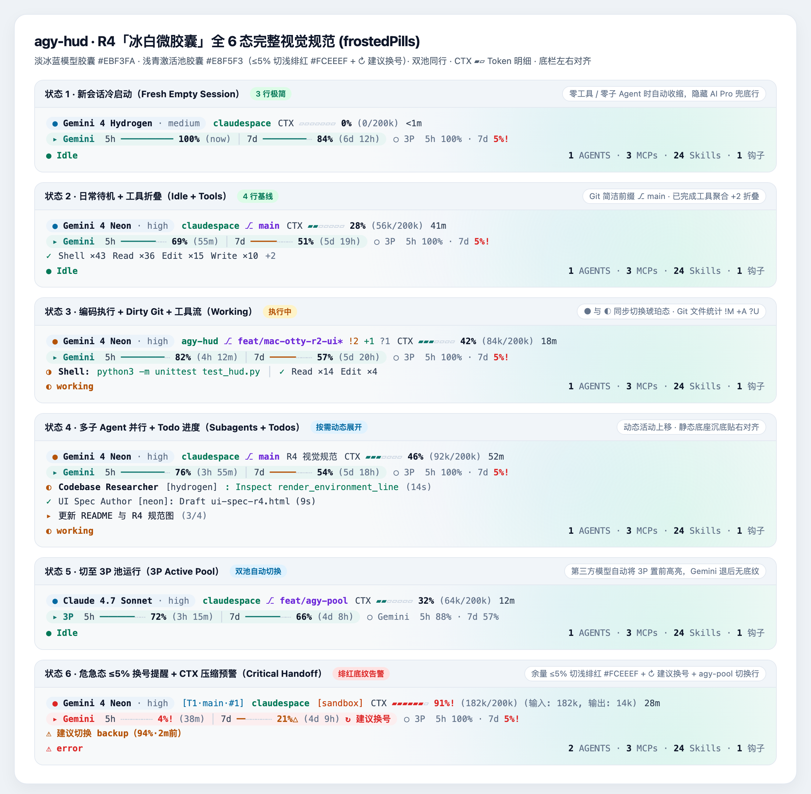
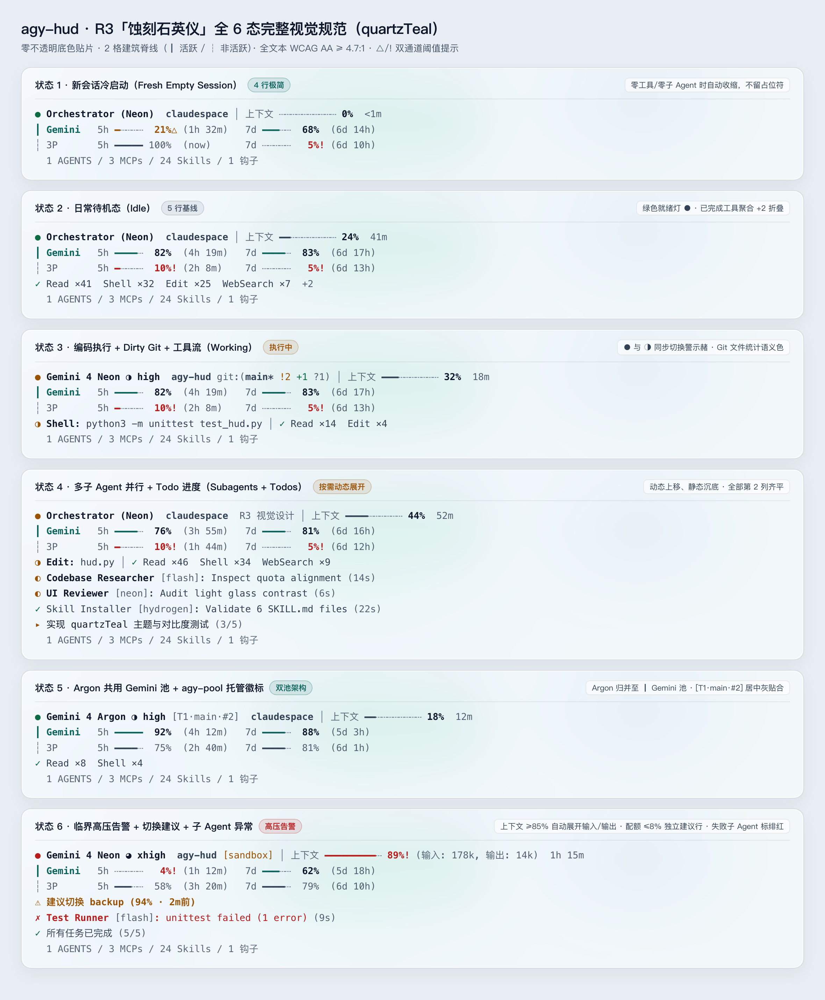
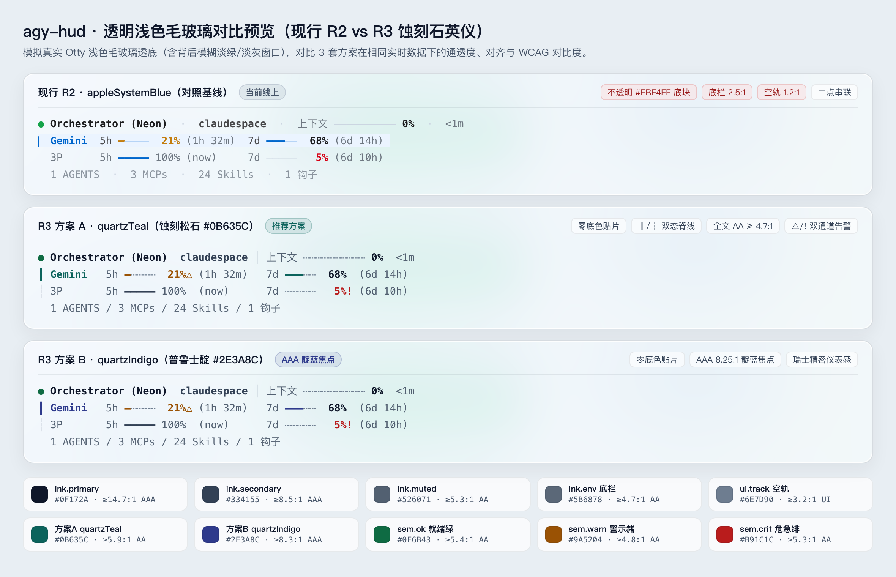
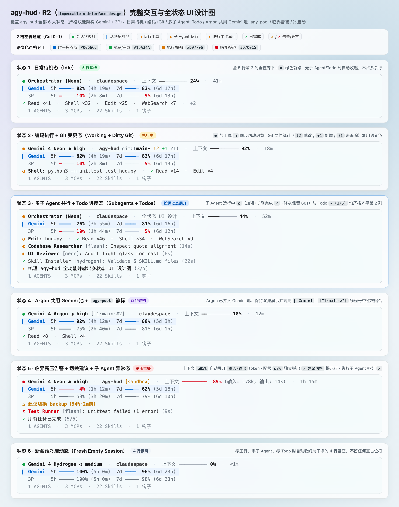

# agy-hud — Antigravity CLI 状态栏 HUD 插件

参考 Claude Code 的 `claude-hud` 设计，为 Antigravity CLI (`agy`) 打造的中文实时状态栏插件（纯 Python 标准库，零外部依赖，已避开 Windows `cmd /c` 路径引号转义坑）。

## 显示内容（R4 `frostedPills` 默认形态）

```text
● Gemini 4 Neon · high  claudespace  ⎇ main* !2 +1  CTX ▰▰▱▱▱▱▱ 28% (56k/200k)  41m
▸ Gemini  5h ━━━━┄┄ 69% (55m) │ 7d ━━━┄┄┄ 51% (5d 19h)  ○ 3P  5h 100% · 7d 5%!
✓ Shell ×43  Read ×36  Edit ×15  Write ×10  +2
◐ Codebase Researcher [hydrogen]: Search auth middleware (12s)
▸ 实现子 Agent 实时追踪 (2/5)
● Idle                                       1 AGENTS · 3 MCPs · 24 Skills · 1 钩子
```

- **第 1 行**：淡冰蓝圆角微胶囊 `● 模型 · 思考档位`（`●` 随实时状态变色）、托管线程徽章（`agy-pool` 联动时显示 `[T1·main·#1]`）、当前项目目录、简洁 Git 分支 `⎇ branch`（默认开启 `gitStatus.showFileStats` 显示 `!M +A ✘D ?U`）、会话标题（`conversation_title`）、`CTX ▰▱` 上下文进度条（`frostedPills` 默认开启 `contextValue: "both"`，同时显示百分比与柔灰 `(56k/200k)` Token 明细）以及会话时长。
- **第 2 行**：**AGY 原生双配额池同行微胶囊**：
  - 固定采用 **Gemini 池**（`gemini-5h` / `gemini-weekly`，涵盖全系 Gemini 模型，历史 `argon` 键自动归并至 Gemini 池）与 **第三方 3P 池**（`3p-5h` / `3p-weekly`，如 Claude/GPT 系列）双池架构；不再展示冗余的 `AI Pro` 套餐行。
  - 当前激活池独占清透浅青胶囊 `▸ Pool ...`（若任一窗口剩余 `≤5%` 自动切为柔和浅绯红微底纹 `#FCEEEF` 并提示 `↻ 建议换号`）；备用池保持无底纹柔灰 `○ Pool ...` 退后（仅 `≤5%!` 红标穿透）；窄终端下自动拆分为两行不断裂胶囊。
  - 可在 `config.json` 中切换 `quotaPools`（`"both"` 全池同显 / `"active"` 仅显示当前模型所在池）和 `usageValue`（`"remaining"` 显示剩余% / `"used"` 显示已用%）。
  - 在 `agy-pool` 托管会话下，支持红色账号不符告警（`⚠ 账号不符`）、低额度三态切换提醒（默认 `8%`，可在 `pool.lowQuotaThresholdPercent` 调整）以及 5 秒防抖回写 `pool.db`。
- **动态活动区（第 3+ 行，按需上移）**：实时解析当前会话 `transcript.jsonl` 的工具调用统计（运行中 `◑` │ 已完成 `✓ 工具 ×次数` + `+N`）、子 Agent 实时追踪（融合 `stdin.subagents` + 父子 `transcript.jsonl` + `/swarm` worker，默认完成态保留 `agentCompletedRetentionSeconds: 60` 秒）与 Todo 任务进度（优先解析 `brain/<conv_id>/task.md`）。
- **最底行（静态底座 & 实时状态）**：左对齐实时状态灯（`● Idle` / `◐ working` / `⏳ waiting` / `⚠ error`），右侧自动贴齐上方内容边缘展示 `AGENTS / MCPs / Skills / 钩子`（加粗数字配柔灰单位）；传统 `default` 等旧主题仍保持完全兼容。

## 主题预设与 macOS Otty 浅色玻璃 UI

> 分支说明：`feat/mac-otty-r2-ui` 为 **macOS Otty 浅色毛玻璃专用分支**（不合入 `main`）；R4 默认设计语言规范与后续迭代指南见 [docs/ui-spec-r4-frosted-pills.md](./docs/ui-spec-r4-frosted-pills.md)（仓库协作者与 Agent 约束见 [AGENTS.md](./AGENTS.md)）。



<details>
<summary>查看历史 R3（quartzTeal）与 R2 视觉规范图</summary>

- [docs/ui-spec-r2.md](./docs/ui-spec-r2.md)







</details>

| 主题名 (`theme`) | 定位与适用场景 | 核心视觉特点 |
| :--- | :--- | :--- |
| `frostedPills` | **推荐 · macOS Otty R4「冰白微胶囊」** | 淡冰蓝模型胶囊 `#EBF3FA`、激活池浅青圆角微胶囊 `#E8F5F3`（`≤5%` 切浅绯红 `#FCEEEF` + `↻ 建议换号`）、双池同行（窄屏自动折行）、`CTX` `▰▱` + `(used/limit)` Token 明细、`Idle` 左对齐 + 能力计数贴右对齐，支持 `"pillRounded": false` 纯矩形回退 |
| `quartzTeal` | macOS Otty R3「蚀刻石英仪」 | 无配额行背景色，`┃` / `┆` 区分活跃池与非活跃池，`△` / `!` 提示预警与危急 |
| `appleSystemBlue` | macOS Otty 浅色玻璃（R2） | 2 格左脊齐平、`●` 实时状态灯、`#0066CC` 仅聚焦活跃池、浅冰底 `#EBF4FF`、动态上移静态沉底 |
| `mintlifyGlass` | 浅色玻璃薄荷对比方案 | 薄荷绿 `#009975` 强调色、薄荷雾活跃行 `#E6FAF5`、5 格双池迷你进度条 |
| `appleVibrancy` | Apple 浅色玻璃过渡方案 | 品红模型名 + 藏青项目路径 + `#1856FF` 浅冰活跃池 |
| `default` | 经典深色 CLI 终端样式 | 兼容传统终端底色的经典暗色布局 |

在 `~/.antigravity/agy-hud/config.json` 中设置即可生效：

```json
{
  "theme": "frostedPills"
}
```

## 安装

- **macOS / Linux**：

```bash
./install.sh
```

- **Windows（PowerShell）**：

```powershell
.\agy-hud\install.ps1
```

安装后重启 `agy` 即可生效。配置文件位于 `~/.antigravity/agy-hud/config.json`，可随时按需开关各模块。

## 隐私与遥测（Telemetry）提示

- `agy-hud` 本身是纯本地脚本，不上传任何数据到云端，也不会在 Windows 上弹出黑框窗口。
- 如需关闭 Antigravity CLI（`agy`）自身的遥测/产品改进数据上报：在 `agy` 中输入 `/settings`（或 `/config`），将 **Enable Telemetry** 切换为关闭即可。
- 在 PowerShell 中可快速自查是否已关闭：

```powershell
Select-String -Path "$env:USERPROFILE\.gemini\antigravity-cli\settings.json" -Pattern "telemetry"
```

看到 `"enableTelemetry": false` 即表示关闭成功（不影响正常对话、改代码与状态栏功能）。
