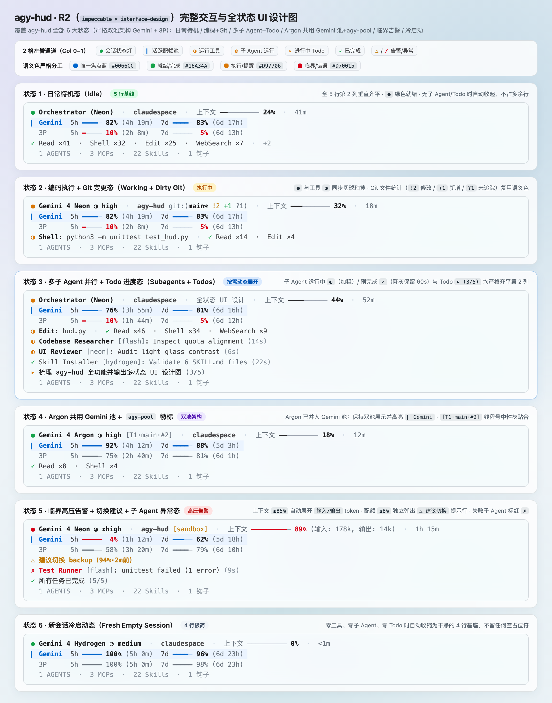

# agy-hud · R2（`impeccable × interface-design`）macOS Otty 浅色玻璃 UI 规范



> 适用主题：`appleSystemBlue`（适配 macOS Otty `glass-light-custom` `#F7FBFD66` 浅色毛玻璃背景）。  
> 配额池架构：严格双池架构（**Gemini** + **3P**）；**Argon 已并入 Gemini 配额池**，使用 Argon 模型时共用并高亮 `▎ Gemini`。

---

## 一、`agy-hud` 全功能盘点与显示规则

| 模块 | 数据来源（`hud.py`） | 触发与显示规则 |
| :--- | :--- | :--- |
| **1. 头栏（Project Line）** | `model` + `agent_state` + `pool_ctx` + `cwd` + `gitStatus` + `session_name` + `sandbox` + `context_window` + `duration` | 常驻；`●` 随 `agent_state` 变色；`[T1·main·#2]` 仅在 `agy-pool` 托管时出现；Git 仅在 Git 仓库内展示 `!M +A ✘D ?U`；上下文 `≥85%` 自动展开 `(输入: X, 输出: Y)` |
| **2. 双配额池（Quota Pools）** | `stdin.quota`（或本地 fallback） | 按 **Gemini / 3P** 双池对齐；当前活跃池置顶并高亮（含 `Gemini 4 Argon` 归入 `Gemini` 池） |
| **3. 独立告警行（Pool Alert）** | `pool_ctx` + `accounts` | 账号邮箱不符（红警）或主池余量 `≤8%` 时，在配额池下方**独立成行**展示 `⚠ 建议切换 <alt>` / `⚠ 账号不符` |
| **4. 实时工具调用（Tools）** | `transcript.jsonl` | 有工具调用后出现；运行中显示最近 2 个 `◑ 工具: 目标`，已完成折叠为前 4 项 `✓ 工具 ×N` + `+M` |
| **5. 子 Agent 实时追踪（Subagents）** | `stdin.subagents` + 子 `transcript.jsonl` + `/swarm` | **仅在存在运行中或完成 60s 内的子 Agent 时显示**（最多 3 行）；展示 `角色 [模型]: 任务摘要 (耗时)`；支持 `◐` 运行中、`✓` 完成、`✗` 异常 |
| **6. Todo 进度与静态环境（Todos & Env）** | `task.md` / `transcript` + `.gemini`/项目扫描 | Todo **仅在存在任务列表时显示**（`▸ 任务 (x/y)` 或 `✓ 所有任务已完成 (y/y)`）；环境计数常驻最底行 |

---

## 二、R2 左脊齐平控制台设计规范

1. **统一 2 格左脊通道（Col 0–1）**：所有行内容均从第 2 列对齐起跳——`● `（实时会话状态灯）、`▎ `（唯一带浅冰底 `#EBF4FF` 的活跃池）、`  `（非活跃池与底栏环境）、`◑/✓`（工具）、`◐/✓/✗`（子 Agent）、`▸/✓`（Todo）、`⚠ `（独立告警）。
2. **语义色严格分工**：
   - **唯一焦点蓝 `#0066CC`**：仅用于活跃配额池（`▎`、池名与健康条），严禁扩散到上下文或非活跃池。
   - **状态绿 `#16A34A`**：`idle` 状态灯、已完成 `✓`、Git `+added`。
   - **执行/告警琥珀 `#D97706` / `#C37D0D`**：`working`/`waiting` 状态灯、运行中 `◑`/`◐`、进行中 Todo `▸`、低额度切换提示、`[sandbox]`、Git `!modified`。
   - **临界/异常红 `#D70015`**：`error` 状态灯、失败子 Agent `✗`、上下文/配额危机、账号不符告警、Git `✘deleted`。
3. **中性墨阶与 WCAG AA 对比度**：主墨 `#1D1D1F` → 次墨 `#48484A` → AA 辅助墨 `#6E7781`（非活跃池 `[T1·main·#2]` 与重设倒计时）→ 静默底栏 `#8C959F` → 头发丝分隔符 `#CBD5E1`；健康上下文采用石墨条 `#27272A`。
4. **动态上移、静态沉底**：工具（第 4 行）→ 子 Agent（按需）→ Todo（按需）→ 静态环境计数统一置于最底行。

---

## 三、本地 macOS Otty 启用方式

在 `~/.antigravity/agy-hud/config.json` 中设置：

```json
{
  "theme": "appleSystemBlue"
}
```

然后执行 `./install.sh`（非 `default` 主题不会强制关闭 `showQuotaBars`）。
